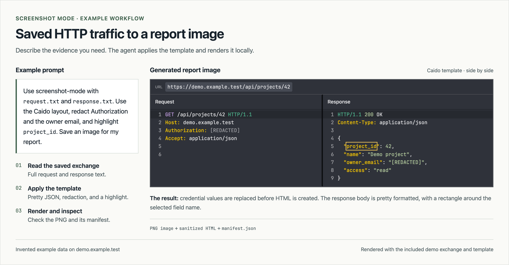

# Screenshot Mode

An agent skill that turns captured HTTP requests and responses into images for security reports. Use full traffic text from Burp Suite, Caido, mitmproxy, ZAP, curl, or another capture tool. No proxy plugin is required.

## Install

```bash
npx skills add vichhka-git/screenshot-mode
```

The agent checks the runtime when you use the skill and installs missing dependencies as needed. Runtime setup is covered in the skill instructions.

## Use it

Give your agent the captured traffic and describe the image you need:

> Use screenshot-mode with request.txt and response.txt. Use the Caido layout, redact Authorization and the owner email, and highlight project_id. Save an image for my report.



This example uses invented traffic on `demo.example.test`. The image on the right is produced by the skill's renderer. The [example exchange](docs/examples/demo-exchange.json) and [template](docs/examples/report-template.json) are included in this repository so an agent can reproduce it. The [custom template](docs/examples/custom-template.json) and [stylesheet](docs/examples/custom-style.css) show another report style.

## Rendering

Caido is the default template. JSON and form bodies are pretty formatted by default; ask for raw mode when whitespace matters.

- Choose side by side or stacked panels, preset or custom widths, and font size.
- Highlight text or draw rectangles around it. Redact values and hide headers, bodies, or selected lines.
- Show supplied timestamps, response size, and duration. Missing metadata stays absent.
- Ask the agent to adjust colors, spacing, or CSS, or create a reusable JSON template.

Inputs can be raw HTTP files, exchange JSON, or HAR exports. Output includes PNG images, sanitized HTML, and a manifest of the applied transformations. Review the images before sharing; automatic credential redaction does not cover every sensitive field.

See the [skill instructions](skills/screenshot-mode/SKILL.md), [input formats](skills/screenshot-mode/references/inputs.md), and [template customization](skills/screenshot-mode/references/customization.md).

## Credits

Inspired by [Screenshot Mode from the Caido community](https://github.com/caido-community/screenshot-mode). Its traffic layout and reporting features informed this independent renderer and default template. The original Caido Labs copyright notice is retained in [LICENSE](LICENSE).

The bundled JetBrains Mono font is distributed under the [SIL Open Font License](skills/screenshot-mode/assets/fonts/OFL.txt).
