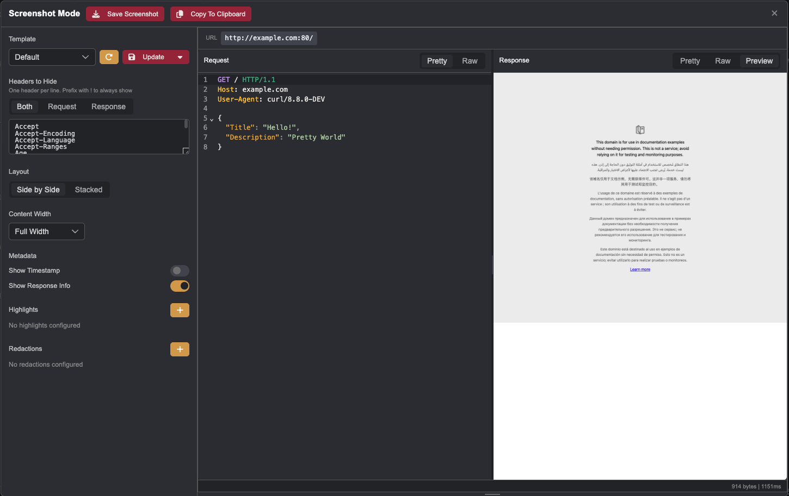

<div align="center">
  

  <br />
  <br />
  <a href="https://github.com/vichhka-git/screenshot-mode" target="_blank">Github</a>
  <span>&nbsp;&nbsp;•&nbsp;&nbsp;</span>
  <a href="https://developer.caido.io/" target="_blank">Documentation</a>
  <span>&nbsp;&nbsp;•&nbsp;&nbsp;</span>
  <a href="https://links.caido.io/www-discord" target="_blank">Discord</a>
  <br />
  <hr />
</div>

# Screenshot Mode++

Create screenshots of requests and responses inside Caido. No external tools.



## Views

The request and response panels each have a view switch.

| Panel | Views |
| --- | --- |
| Request | Pretty, Raw |
| Response | Pretty, Raw, Preview |

Pretty formats JSON, HTML, XML, and form-encoded bodies with two-space indentation. The start line and headers stay as captured. Raw shows the message without changes. Headers you hide are removed in every view. Each Replay tab keeps its own selection.

### Preview

Preview renders the selected response the way a browser would show it. Use it for HTML pages and error documents where raw markup is hard to read.

Caido's rendering engine is required. Install it from Settings > Rendering in Caido's account menu. If the engine is missing, the panel shows what to install.

## Annotations

The annotation bar sits under the overlay header. Pick a tool, a color, a stroke size, and a text style, then draw on the capture.

- Select picks annotations. Drag to move, drag a corner handle to resize, or press Delete to remove. Shift-drag empty space to select several at once. Shift-click adds one to the selection or removes it. Plain drags still select text, so you can highlight or redact it with Caido's tools. Right-click opens the text menu.
- Pen and highlighter draw freehand.
- The Shapes menu holds line, arrow, outline arrow, rectangle, rounded rectangle, ellipse, triangle, star, hexagon, heart, speech bubble, and thought bubble. Pick a shape, then drag on the capture.
- Line, arrow, and outline arrow show a handle at each end. Drag either end to change length and angle.
- Text adds a label. Double-click a label to edit it.
- Numbered step drops the next number in sequence.
- Black box covers the content underneath.

Use the swatches or the custom color picker for any color. The size menu sets line weight. The Shape style popover fills a closed shape, switches to a dashed line, or adds arrowheads at either end. Fill uses the line color at 20 percent opacity. The Text style popover sets the font family, size, bold, italic, and underline. Sizes accept any value from 1 to 300 px. Use the indent buttons to inset a label, and Box to draw a rounded background behind it. Selecting an annotation loads its color, line weight, shape style, and text style into the bar. Changes apply to the selection. While you edit a label, font and style changes keep the edit open until you click outside the style controls. Shape, text, step, and redaction tools return to Select after one use. Pen and highlighter stay active for several strokes. Right-click cancels the active tool and returns to Select.

Undo with Cmd+Z on macOS or Ctrl+Z on Windows. Redo with Cmd+Shift+Z, Ctrl+Shift+Z, or Ctrl+Y. Undo, redo, and clear also sit on the bar. Annotations are redrawn at export resolution, so they stay sharp in the PNG and in the clipboard copy.

## Installation

### From a release

1. Download `plugin_package.zip` from the [latest release](https://github.com/vichhka-git/screenshot-mode/releases/latest).
2. In Caido, open Plugins and click Install Package.
3. Select the downloaded file.

This fork uses its own plugin identifier, so uninstall the official Screenshot Mode plugin to avoid duplicate toolbar buttons and shortcuts.

### From source

1. Install dependencies:

   ```bash
   pnpm install
   ```

2. Build the plugin:

   ```bash
   pnpm build
   ```

3. Install `dist/plugin_package.zip` from Caido's plugin settings.

## Usage

1. Open Replay, open a tab, and click Screenshot.
2. Pick a view for the request and response.
3. Hide headers, add highlights or redactions, and draw annotations if needed.
4. Choose Save Screenshot or Copy To Clipboard.

## Development

```bash
pnpm install
pnpm typecheck
pnpm lint
pnpm test
pnpm build
```

## License

MIT. See [LICENSE](LICENSE).

Maintained by [vichhka-git](https://github.com/vichhka-git).
